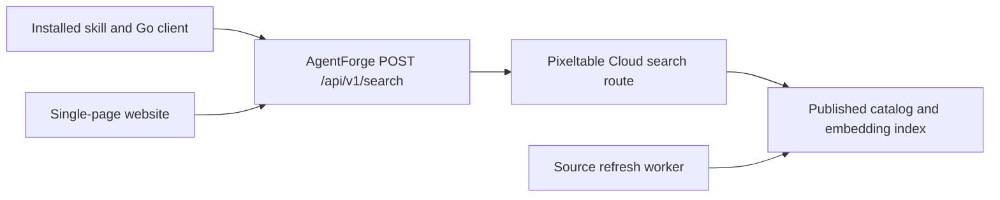

# AgentForge discovery service PRD

AgentForge connects a person's ordinary request to useful skills they did not
know existed. A small skill in the harness queries a continuously refreshed
catalog, explains relevant capabilities, and offers to use a suitable skill.
A single-page website searches the same catalog through the same public endpoint.

This PRD specifies the target service release. A
[deployed preview](https://agentforge-five-sandy.vercel.app/) and
[platform implementation](https://github.com/agentforge-hq/platform) now exist.
Their availability does not establish that all acceptance criteria below pass.
The founder selected discovery and Pixeltable Cloud on October 24, then accepted
the coverage, relevance, and harness-adoption priorities on October 27. The
[roadmap](roadmap.md) replaces the earlier maintenance-first sequence. The
[competitive review](competitive-landscape.md) records substantial overlap with
existing products. Local audit commands remain available. Company vision changes
and a release claim still require founder review.

## 1. Problem and outcome

People can describe what they want without knowing the techniques, workflows,
or skills that would help. Requiring them to ask for a skill assumes the
knowledge the product should supply.

The first beneficiary is someone already working with an agent who lacks
specialist experience in the current task. Developers using Codex are the first
integration cohort. The catalog can include other kinds of work, with explicit
requirements and compatibility information.

Success means that an ordinary request leads to a relevant, understandable
capability recommendation and, when accepted, the agent uses the selected skill
on the original task. Search results alone establish retrieval behavior.
Improved task outcomes require separate observation.

AgentForge maintains source coverage, metadata, indexing, and retrieval.
Upstream authors own their skills. Editing third-party skills, autonomous
repairs, and a skill-authoring platform are outside this release.

## 2. Release scope

| Included | Deferred |
| --- | --- |
| Public-source discovery and refresh, starting with GitHub and a documented registry connector | A claim to have indexed every skill on the internet |
| Pixeltable Cloud tables, computed enrichment, and an embedding index | A separate vector database or search cluster |
| Hybrid retrieval through one public search endpoint | A hosted agent that performs the user's whole task |
| Automatic discovery in one tested harness integration | Guaranteed automatic invocation in every harness |
| A thin Go search client and a compact discovery skill | A rewrite of the existing local maintenance CLI |
| A single-page website with AgentForge installation and catalog search | Accounts, billing, dashboards, public submissions, and social rankings |
| Source-pinned adoption with the existing inspection and quarantine path | Automatic execution or silent installation of third-party packages |

Native inclusion by harness vendors is a distribution goal. The initial release
must work through a supported installation and demonstrate automatic discovery
without the person naming AgentForge.

## 3. Harness journey

The following interaction is proposed copy, not a recorded test:

> User: Help me prepare a product launch.
>
> Agent: I found a positioning skill that could help define the audience and
> sharpen the message, and a launch-planning skill that could turn that into a
> sequence of activities. Would you like to use either?

The integration follows this sequence:

1. On a new substantive task, the agent forms a short capability query from the
   user's goal. It does not ask the user to authorize a search or name a skill.
2. The installed client calls the shared search endpoint with that query and
   the harness identifier. Local paths, repository contents, and the transcript
   stay local. Setup explains that task-derived search text goes to the service
   and may reach the configured embedding provider.
3. The agent considers the returned capabilities and requirements against the
   user's task. It presents at most two useful options, describing what each
   would enable. It does not paste a ranked directory into the conversation.
4. The person can accept, refine the task, or continue without a skill. A weak
   match, an already covered capability, or a repeated rejected suggestion
   produces no interruption.
5. After acceptance, the client fetches the exact source revision and skill
   directory, inspects the package, and shows any required adoption decision.
   Existing user authorization can cover adoption. A recommendation alone does
   not authorize running downloaded scripts or adding credentials.
6. The agent uses the skill through the harness's supported activation path and
   returns to the original task. If a new session is required, the agent states
   that limitation and provides the task handoff. Writing a file is not proof
   that the current session loaded it.

Routine acknowledgments and follow-up messages within an unchanged task do not
cause another network search. A changed goal can start a new search. Suppress
repeated recommendations within a conversation. If an adequate skill is already
available locally, the agent can use it without another installation.

The first integration targets Codex. Skill metadata can support implicit
invocation, but installation alone does not guarantee invocation. Test the
chosen package and trigger instructions before claiming support. If they miss
the release criteria, investigate a supported hook or harness integration.
Do not substitute an instruction that claims universal execution. OpenAI
currently documents distribution restrictions for plugins containing hooks.
[Skill activation](https://developers.openai.com/plugins/concepts/skills) and
[plugin packaging](https://developers.openai.com/plugins/build/plugins) define
the current integration constraints.

## 4. Single-page website

The website is part of the first service release. It serves two jobs: installing
AgentForge and exploring the same recommendations outside a harness.

The page contains these elements in order:

| Element | Required behavior |
| --- | --- |
| Introduction | Explain that AgentForge helps an agent discover useful skills from an ordinary request. Avoid claims of universal coverage or proven task improvement. |
| Install AgentForge | A harness selector, the tested installation method, a copy button, and a short first-use example that does not mention skill discovery. Show supported status and platform requirements. |
| Search | A labeled field asking "What are you trying to do?", a Search button, an optional harness selector, and example requests. |
| Results | Show the skill name, what it helps accomplish, an example prompt, its source, compatibility evidence, license status, and last source check. |
| Expanded result | Open in the same page. Show applicability, exclusions, requirements, pinned source details, and an adoption action. |
| Footer | Link to source coverage, privacy information, the public skill repository, and the company record. |

Searching requires no account. Submit with Enter or the Search button. Example
requests populate the field and use the same submission path. Do not send a
request on each keystroke. Cancel or ignore an older response when a newer
request starts. Retain the entered query after a failure.

The page distinguishes the initial state, loading, results, no suitable match,
service failure, and rate limiting. A failure must not look like an empty
catalog. A no-match result can suggest a more specific goal. It must not invent
skills. Result text is rendered as untrusted plain text or sanitized Markdown.

The installation card uses commands and release URLs from a verified release
manifest. Validate a clean installation on each advertised platform before
publishing its command. The current native bundles and the proposed cloud search
client are different releases. Do not show an install command for an unbuilt
client, or advertise a generic command as native support for every harness.

The primary install action installs AgentForge. A result's adoption action
refers to that particular third-party skill and preserves its revision and
subdirectory. The website cannot claim to install into an unrelated local
agent without a supported integration.

At a 360-pixel viewport, the page has no horizontal scrolling. Search, installation,
and results work by keyboard. Fields have labels, loading and result counts have
accessible announcements, and copy actions show success or failure. Search text
does not enter the URL or analytics by default.

## 5. One search contract for both clients

Both the website and installed client call `POST /api/v1/search` on the configured
AgentForge public origin. The production hostname is a deployment setting.
There is one ranking implementation. Client identity cannot change eligibility,
ordering, or result content for the same request and catalog revision.

The proposed request is:

```json
{
	"query": "Review an authentication change for permission bugs",
	"harness": "codex",
	"limit": 5
}
```

| Field | Contract |
| --- | --- |
| `query` | Required nonempty text after trimming. Maximum 2,048 UTF-8 bytes. This is a capability query, not a full conversation. |
| `harness` | Optional documented identifier. Omission permits all harnesses. An unknown identifier is a validation error. |
| `limit` | Integer from 1 through 20. Default 5. The skill requests at most 3 candidates and presents at most 2. |

Requests accept JSON only, with an 8 KiB body limit. Reject unknown fields rather
than accepting accidental transcript uploads. Search reads the catalog and does
not persist a query row or start ingestion, enrichment, or installation.

The following response is illustrative fixture data. Its source is a placeholder:

```json
{
	"rows": [
		{
			"skill_id": "fixture/auth-review",
			"name": "auth-review",
			"summary": "Review permission checks and authentication failure paths.",
			"capabilities": ["Permission checks", "Authentication failure analysis"],
			"example_prompts": ["Review this change for missing permission checks."],
			"requirements": ["Repository access"],
			"exclusions": ["Penetration testing of a deployed service"],
			"match_evidence": {"terms": ["permission"], "example_prompt_index": 0},
			"compatibility": {"harness": "codex", "status": "declared"},
			"license": {"identifier": null, "status": "unknown"},
			"source": {
				"url": "https://example.com/skills/auth-review",
				"revision": "<immutable upstream revision>",
				"skill_path": "skills/auth-review",
				"package_sha256": "<reviewed package digest>",
				"checked_at": "2026-10-24T12:00:00Z"
			},
			"adoption_status": "metadata_only"
		}
	],
	"meta": {
		"status": "matches",
		"retrieval_mode": "hybrid",
		"catalog_revision": "<published catalog revision>",
		"ranking_version": "hybrid-v1",
		"request_id": "<opaque request identifier>"
	}
}
```

`meta.status` is `matches` or `no_match`. `rows` is empty for `no_match`.
`retrieval_mode` is `hybrid` or `lexical_only`. A request can succeed with
lexical-only results during an embedding-provider outage, but must identify that
mode. Apply a separately evaluated lexical-only relevance threshold. If the
catalog itself is unavailable, return a service error.

Compatibility status is `tested`, `declared`, `inferred`, or `unknown`. A tested
claim also carries the harness version, check date, and evidence reference.
Known incompatibility excludes a result for that harness. Unknown support is
visible and cannot become a positive compatibility claim. `adoption_status` is
`review_required`, `metadata_only`, or `unavailable`. Missing license information
defaults to metadata-only discovery with an upstream link.

Results contain bounded metadata, not the full `SKILL.md`, script bodies, or
commands copied from an upstream description. The agent explains relevance from
the returned facts. The service does not call a generative model to write a
custom recommendation on every search. Ranking scores are internal diagnostics,
not probabilities of task success.

Both clients consume the checked-in OpenAPI contract. A shared fixture must
produce the same ordered skill IDs, revisions, metadata, and retrieval mode in
each client. Opaque request IDs can differ. The website has no separate search
route, embedding model, or ranking formula.

| Condition | HTTP behavior |
| --- | --- |
| Suitable results or no suitable match | 200 with the envelope above |
| Body exceeds limit | 413 |
| Unsupported content type | 415 |
| Invalid fields, query, or limit | 422 with field errors |
| Public request limit exceeded | 429 with `Retry-After` |
| Search deadline exceeded | 504 with a stable error code |
| Catalog unavailable | 503 with a stable error code |

Error bodies contain `error.code`, a safe `error.message`, and `request_id`.
They must not expose Cloud credentials, internal URLs, or upstream tracebacks.
Set an 8-second public request deadline and a shorter upstream deadline. Neither
client retries automatically during an interactive task. Honor `Retry-After`
before a later attempt.

## 6. Pixeltable Cloud architecture

Pixeltable Cloud is the system of record for source records, immutable skill
versions, derived search documents, and crawl runs. Computed columns produce
normalized metadata and prompt examples from a source version. A model-declared
embedding index covers the search text. No second database stores embeddings.
Pixeltable documents automatic embedding-index maintenance as table data changes.
[Embedding indexes](https://docs.pixeltable.com/platform/embedding-indexes).

The platform's `app.py` declares `TableModel` classes, indexes under `__indexes__`,
and the service routes. Named `@pxt.query` functions retrieve candidates. The
semantic query uses `.similarity(string=query)`. A synchronous service handler
in the same application fuses bounded lexical and semantic candidates and
returns the search envelope. Simple single-query routes can use
`FastAPIRouter.add_query_route()`. The hybrid route must not assume that an
arbitrary Python fusion function can be passed as an `@pxt.query`.
[HTTP serving](https://docs.pixeltable.com/howto/deployment/serving) and
[synchronous handlers](https://docs.pixeltable.com/howto/deployment/operations)
describe the supported serving patterns.

The network path is:



The public endpoint is a small forwarding layer. It accepts the public request,
enforces request bounds, rate limits, and deadlines, and forwards to a fixed
Pixeltable service URL with a server-held Cloud key. It returns the search
response without reranking. It cannot proxy arbitrary URLs or expose ingestion
routes. The website can be served from the same origin, avoiding cross-origin
browser setup. The Go client calls that same public origin.

Hosted Pixeltable HTTP services use a Cloud credential. Browsers and distributed
skill bundles must not contain that credential. The forwarding layer retains it
server-side and adds `X-api-key`. A direct public Cloud route is an alternative
only after an explicitly supported credential-free or suitably scoped public
access mechanism is verified. [Cloud service authentication](https://docs.pixeltable.com/cloud#call-the-hosted-service).

At implementation time, pin the Pixeltable release and dependencies. Provision
the project runtime with `pxt db update`, apply tables with `pxt schema update`,
then start HTTP with `pxt service update`. All commands target the selected
`pxt://` database. Discover service URLs from the platform rather than guessing
hosts. A successful schema update does not prove HTTP availability.
[Cloud deployment](https://docs.pixeltable.com/cloud#first-deployment).
The preview demonstrates a hosted route. Its current implementation and limits
are in the [platform README](https://github.com/agentforge-hq/platform#current-limits).
The model above describes target behavior, including work still to be verified.

## 7. Data and indexing

| Record | Required data and purpose |
| --- | --- |
| `sources` | Stable skill identity, source kind, repository or registry URL, repository-relative skill directory, aliases, refresh cursor, observed revision, and published revision pointer. |
| `skill_versions` | Immutable revision and content digest, source manifest, permitted source snapshot, author-provided fields, extraction result, model and extraction versions, compatibility evidence, license information, and readiness status. |
| `search_documents` | Version ID, document kind, normalized search text, lexical fields, generated example prompts, and embedding-index coverage. |
| `crawl_runs` | Source, start and finish times, cursor, status, retry information, discovered and changed counts, and safe error classifications. |

Identity includes the source and skill subdirectory. A repository containing
ten skills yields ten identities. A name alone cannot identify a skill. Track
duplicate content and declared aliases without collapsing divergent forks or
harness variants into one interchangeable package.

Keep author-provided metadata separate from AgentForge's inferred capabilities
and generated examples. Each generated field has an extraction version and
source revision. Failed extraction remains visible as an indexing error.
Invented requirements or compatibility claims must not enter published metadata.

The first enrichment produces a concise purpose, capabilities, requirements,
exclusions, and several natural-language example requests. Index the summary and
examples so a request can match without sharing the author's terminology. Treat
source instructions as untrusted input during extraction. Never execute a
downloaded script to index a skill.

Source updates create a new immutable version. Publish the source's revision
pointer only after its required metadata and search documents are ready. Until
then, continue serving the previous complete version with its real freshness
date. A query captures a catalog revision and must not mix document versions
for one skill. Repeating a crawl or insert does not duplicate an identity,
version, or search document. Changing an extraction or embedding model requires
an explicit backfill and release check before switching serving traffic.

## 8. Retrieval behavior

The first ranker has two candidate paths over the same published catalog:

1. Lexical retrieval matches normalized names, publishers, capability terms,
   and example text. Exact identifiers retain a useful route into the results.
2. Semantic retrieval embeds the query and searches the Pixeltable index over
   purpose and example documents.
3. Apply publication, withdrawal, and known harness-incompatibility filters
   within each candidate path before its candidate limit. Collapse multiple
   matching documents into one candidate per skill in each path.
4. Fuse the two bounded lists using reciprocal rank fusion. A skill's score is
   the sum of `1 / (60 + rank)` for the paths where it appears. Use stable skill
   IDs to break ties. Start with at most 50 candidates from each path.
5. Apply the evaluated relevance rule and return at most the requested limit.
   The service can return fewer results or none. A high rank within a poor list
   is insufficient evidence of relevance.

The release does not assume a built-in BM25 index in Pixeltable. Begin with
lexical predicates and scoring supported by the pinned SDK. The retrieval spike
must establish execution behavior and cost at the pilot catalog size. A full
table scan that misses the latency or cost target blocks launch and requires a
reviewed indexing change. Do not silently add another search database or describe
substring matching as BM25.

Enrichment runs when indexed content changes. An uncached semantic search still
requires a query embedding. Record that dependency and its cost. Repeated queries
may use a short-lived cache keyed by normalized request, catalog revision, and
ranking version. User query text is not stored in an analytics table by default.
Operational logs retain request IDs, timing, retrieval mode, and catalog revision.
Exclude raw request bodies and queries from application and forwarding logs.
Document the chosen embedding provider's data handling during setup.

Calibrate hybrid and lexical-only relevance rules on separate development cases.
Freeze those rules before the held-out release evaluation. Generated prompt
examples used for indexing are not independent evaluation evidence.

## 9. Source refresh and continuous operation

Start with explicit seed repositories and a registry connector that resolves
entries to an upstream skill directory. Registry listings are discovery hints.
Pin the upstream revision and verify that the skill actually exists there.
Prefer documented APIs, feeds, or permitted retrieval mechanisms for each source.

Run an initial manual crawl before enabling recurring refresh. Persist cursors
and conditional-fetch information. Retry transient failures with backoff and
respect source rate limits. Bound download sizes, extracted files, linked
resources, redirects, and the crawl frontier. Crawl workers do not share the
public search route's runtime budget.

For the pilot, recheck registered sources at least daily and attempt new-source
discovery daily. This is a proposed operating target. Publish coverage counts
and actual last-check times. A missed check or temporary authorization failure
does not prove deletion. Mark a confirmed removed source withdrawn and exclude
it from adoption. A temporary failure preserves the last good record and marks
its freshness accurately. An operator can withdraw a harmful listing immediately.

Continuous service means an available read path plus recurring bounded indexing
jobs. It does not require an LLM agent to run continuously. Monitor search
availability, latency, provider failures, pending indexing work, freshness, and
withdrawal propagation. Alert on actionable failures. Keep indexing and search
spend caps configurable, with further paid deployment requiring founder approval.

## 10. Repository and release boundaries

Use `agentforge-hq/platform` for the Cloud application,
refresh code, shared API schema, single-page website, and small public forwarding
handler. The target module layout below is a proposal. See the platform
repository for its current file structure:

```text
platform/
  app.py
  pyproject.toml
  pixeltable.toml
  ingest/
  web/
  gateway/
  contracts/search.openapi.json
  tests/
  LICENSE
```

Keep the Go client and harness skill in `agentforge-hq/agentforge`. Add a proposed
`agentforge search` command for the service. Preserve the existing GitHub
repository search behavior under its existing command. Cloud failures must not
silently fall back to another provider and disclose a query elsewhere.

The skill and client remain Apache-2.0. Original platform code, website code,
and company documents remain proprietary with all rights reserved. Public
visibility does not grant an open-source license. Upstream skill licenses are
recorded separately. Do not apply AgentForge's license to upstream packages.

## 11. Release sequence and acceptance

The figures below are proposed pilot gates, not measured performance or demand.

| Stage | Owner | Observable completion |
| --- | --- | --- |
| A: retrieval spike | Engineering | A pinned Pixeltable release stores fixture versions, updates an embedding index, runs both retrieval paths, and serves their fused results. Cloud authentication and the public forwarding path are demonstrated. |
| B: initial catalog | Engineering | At least 500 distinct skill directories from at least two source kinds are indexed. Source changes, duplicate names, extraction failure, removal, and repeat ingestion have recorded outcomes. |
| C: both clients | Engineering and design | The Go client and single-page website use the same endpoint and pass contract parity checks. Tested AgentForge installation is available for the advertised harness and platforms. |
| D: automatic discovery | Product and engineering | Fresh-session prompts trigger search without mentioning AgentForge, and accepted adoption demonstrably loads or hands off the selected pinned skill. |
| E: controlled pilot | Product and operations | Held-out relevance and interruption gates pass. A 48-hour refresh and availability observation completes before a public launch decision. |

Release acceptance includes these checks:

| ID | Check |
| --- | --- |
| AC-01 | On a fixed catalog revision, identical website and CLI requests return the same ordered identities, revisions, metadata, and retrieval mode. |
| AC-02 | Name matches, terminology-free outcome requests, multi-skill repositories, duplicate names, and harness incompatibility each have a recorded retrieval case. |
| AC-03 | Freeze 100 human-reviewed prompts before final tuning: 50 skill-relevant requests, 25 substantive requests with no useful catalog match, and 25 trivial messages. At least 40 of the 50 relevant requests have an approved result in the top three. |
| AC-04 | In fresh sessions, at least 45 of the 50 relevant requests trigger discovery without naming AgentForge. At most 2 of the 25 no-match tasks produce an inappropriate recommendation. None of the 25 trivial messages causes a skill recommendation or network search. Record search calls separately from visible suggestions. |
| AC-05 | A user can reject a recommendation, continue the original job, and avoid a repeated interruption. Accepted adoption uses the returned revision and directory, and states any activation limitation. |
| AC-06 | A clean install reaches its first automatic discovery in the advertised harness. Removing AgentForge does not remove unrelated skills or rules. |
| AC-07 | No-match, rate-limit, deadline, catalog failure, stale source, and lexical-only operation are distinguishable in both clients. A search outage leaves the original task able to continue. |
| AC-08 | Changing one upstream skill updates that identity and dependent search documents without duplicate records. A failed refresh leaves the previous complete revision available. A confirmed withdrawal disappears from adoption results within the next successful refresh. |
| AC-09 | A credential scan and browser network inspection find no Cloud or model-provider secret in static assets, public responses, logs, or distributed bundles. Public requests cannot reach ingestion routes. |
| AC-10 | At 500 published skills and 5 search requests per second, measured warm end-to-end search p95 is at most 2 seconds over a 10-minute run, including query embedding. Record cold starts, errors, provider, resource settings, and cost separately. Cache hits cannot stand in for uncached measurements. |
| AC-11 | The website passes the keyboard, mobile layout, loading, stale-response, and copy-action checks in section 4. A failed request retains the query. |
| AC-12 | The 48-hour observation records source-check freshness, search probes, failed jobs, and actual provider spend. A failed availability or spend check has an owner and a resolution before launch. |

Product owns the prompt labels and usefulness judgments. Engineering owns
repeatable fixtures and execution records. Design owns the observed installation
and website journey. Operations owns refresh and availability evidence.
Marketing can use only demonstrated coverage and behavior in launch claims.
Record the harness version, model, settings, installed instructions, and catalog
revision for each evaluation. Keep the evaluator's labels outside the tested
agent's context. Task-quality comparisons use the same inputs and model settings.

## 12. Deployment decisions and remaining checks

The founder authorized the existing MoS Vercel workspace within included usage
and the AgentForge database in the Pixeltable Pro organization. This authority
does not cover plan upgrades, paid add-ons, or unlimited spend.

| Decision | Preview state and remaining evidence |
| --- | --- |
| Storage and public host | The dedicated Pixeltable Cloud database and Vercel website are deployed. The current origin is linked above. |
| Codex invocation mechanism | Discovery preview bundles exist. Fresh-session AC-04 and clean-install AC-06 remain necessary to establish automatic behavior. |
| Embedding and enrichment models | The implementation pins FastEmbed with BAAI/bge-small-en-v1.5. Representative retrieval quality and generated enrichment remain evaluation work. |
| Lexical execution strategy | The preview scores metadata over the bounded catalog. Demonstrate acceptable latency and cost at the stage B size before claiming scale. |
| Anonymous request quota | The gateway uses a best-effort per-instance limit. A shared global quota and a billing guarantee are not established. Test actual behavior and cost in the pilot. |
| Refresh and availability | A recurring refresh workflow exists. AC-12 still requires a recorded 48-hour observation of freshness, failures, availability, and spend. |

Current implementation details do not silently weaken the acceptance criteria.
Record each gap and resolve or explicitly revise it before declaring the target
release complete.

## 13. Evidence and limits

The founder's October 24 direction establishes the product intent and Pixeltable
choice. The linked public documentation establishes available storage, indexing,
serving, and integration primitives. It does not establish AgentForge service
performance, complete source coverage, or automatic invocation reliability.

The existing [v0.1 contract](v0.1-contract-gaps.md) describes the local maintenance
release. Its structural scores and lexical checks remain engineering tools.
The service's adoption, relevance, and task outcomes require the pilot evidence
specified here. The [competitive review](competitive-landscape.md) is based on
primary-source documentation and selected public interfaces. It does not prove
AgentForge beats competing discovery paths. Record the live preview separately
from acceptance and comparative outcome evidence.
